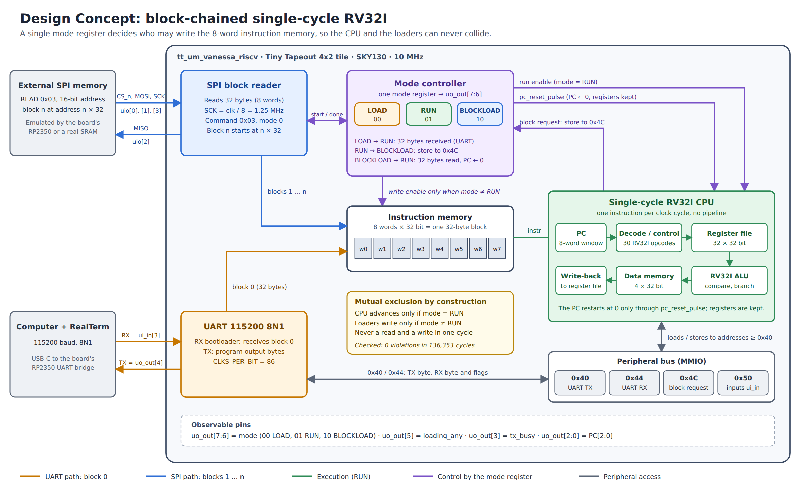
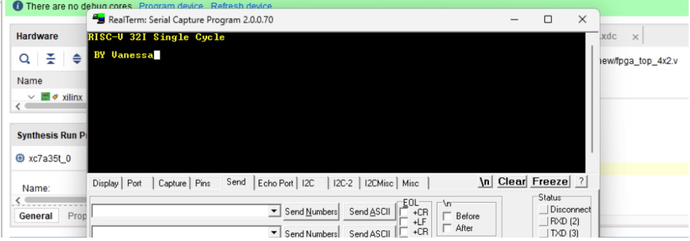
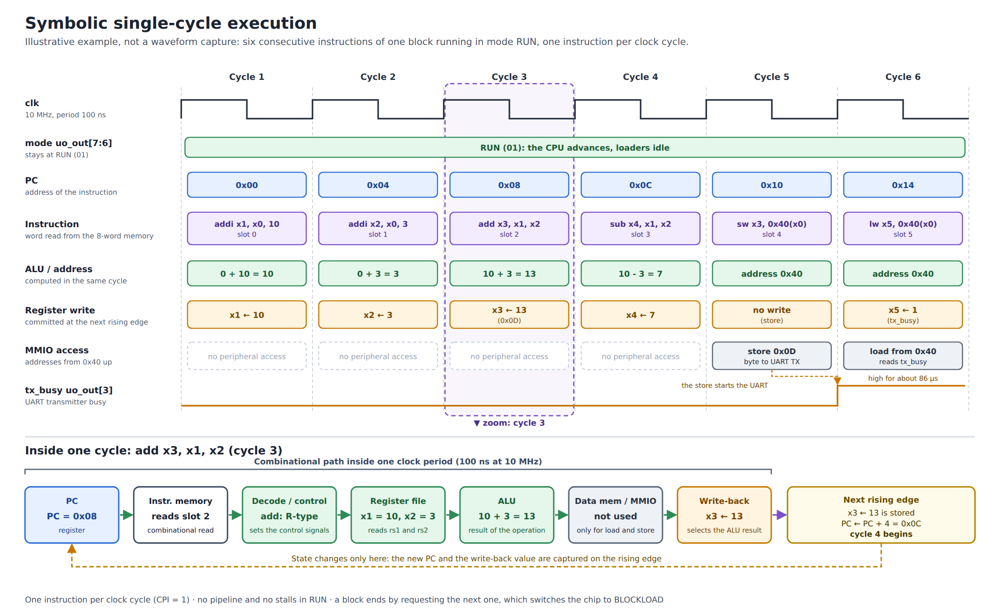

# RV32I Single-Cycle CPU for Tiny Tapeout: `tt_um_vanessa_riscv`

## Overview

`tt_um_vanessa_riscv` is a single-cycle RISC-V (RV32I) CPU designed for fabrication on a
[Tiny Tapeout](https://tinytapeout.com/) shuttle on the SKY130 process. The tile size limits the
on-chip instruction memory to 8 physical words, so the design uses a **block-chained loading
scheme**: programs longer than 8 instructions are read from an external SPI memory in 8-word
(32-byte) blocks. Each block ends by requesting the next one, so the CPU runs complete programs of
24 to 40 instructions without a larger physical memory array.

The design was verified at four levels: a cycle-accurate Python model, cocotb RTL tests, a
gate-level test of the final netlist, and real hardware on a Digilent Basys3 FPGA (Vivado and
RealTerm over UART). Silicon validation is pending.

## Academic Motivation

This project was created with an educational purpose, for students and for anyone motivated to
learn integrated circuit design, whether digital or analog. A complete processor, from the
instruction set down to a layout ready for fabrication, is usually out of reach for a first
project. Here it is documented step by step, with its verification, its mistakes, its limits and
its numbers in the open, so that others can follow the same path, reproduce it and improve it.

Tiny Tapeout makes it possible for a student to turn a design into a real chip, using open-source
tools and a shared shuttle. If you are starting out, take this as an invitation: you do not need a
large team or a large budget to design silicon. Start small, verify everything, learn from every
failed run, and keep going. The first chip is the hardest one, and it is within your reach.


## Project Objectives

- Design a functional RV32I single-cycle CPU that fits the Tiny Tapeout 4x2 tile.
- Prove mutual exclusion between the CPU execution state and the SPI block-loading state, so the
  instruction memory is never read and written in the same cycle.
- Cover the RV32I base set (30/30 instructions verified) with an 8-word physical instruction
  memory, through block chaining.
- Repackage and validate 10 category programs (A, B, C, D, D2, E, F2, G, H_suma, H_resta) on real
  FPGA hardware, not only in simulation.
- Produce a clean, fabrication-ready GDS (SKY130, LibreLane) with a pin assignment verified
  against the Tiny Tapeout specification.

## Project Summary

| Item | Value |
| --- | --- |
| Top module | `tt_um_vanessa_riscv` |
| Process | SKY130 (`sky130_fd_sc_hd`) |
| Target | Tiny Tapeout digital ASIC shuttle |
| Tile size | `4x2` (redesigned from `6x2`) |
| Design type | Digital: RV32I single-cycle CPU with SPI-loaded, block-chained instruction memory |
| Implementation | Standard-cell synthesis (LibreLane: Yosys and OpenROAD) |
| Core / I/O supply | 1.8 V / 3.3 V |
| Clock | 10 MHz |
| UART | 115200 baud nominal, 8N1 (`CLKS_PER_BIT = 86`, real 116,279 baud at 10 MHz, +0.94 %) |
| Reset | `rst_n` used directly, no reset synchronizer |
| Physical instruction memory | 8 words (`INSTR_DEPTH = 8`), 4 data words (`DATA_DEPTH = 4`) |
| ISA coverage | RV32I base set, 30/30 instructions verified |
| UART pinout | `ui_in[3]` = RX, `uo_out[4]` = TX (Tiny Tapeout UART-to-USB, option 1) |
| SPI pinout | `uio[0]` = CS_n, `uio[1]` = MOSI, `uio[2]` = MISO, `uio[3]` = SCK |
| Die area | 682.64 x 225.76 um (154,113 um2, fixed 4x2 tile) |
| Placement target density | 76% (`PL_TARGET_DENSITY_PCT`), 79.3% achieved utilization |
| Afiliación | Universidad Autónoma de Baja California (UABC) |
| Project participant | Vanessa Rocha Pérez |
| Project supervisor | Jose Luis Valtierra Sánchez de la Vega |

## Why 4x2: Redesign from 6x2

The first version used a 24-word instruction memory and 16 data words on a `6x2` tile (12 tiles).
Holding the whole program in on-chip registers dominated the area. The final version keeps only 8
instruction words and 4 data words, and reads the rest of the program from an external SPI memory,
which brings the design to `4x2` (8 tiles, 33% less area).

| Item | 6x2 version | Final 4x2 version |
| --- | --- | --- |
| Tiles | 12 | 8 |
| Instruction memory | 24 words | 8 words, chained in blocks |
| Data memory | 16 words | 4 words |
| Modes | LOAD, RUN | LOAD, RUN, BLOCKLOAD |
| SPI | General-purpose master at `0x48` | Block reader at `0x4C` (read `0x03`, 16-bit address) |
| Program loading | Whole program over UART | Block 0 over UART, the rest over SPI |

## Design Concept

The CPU runs in three modes controlled by a single `mode` register: `M_LOAD` (initial bootload
over UART), `M_RUN` (execute from the 8-word instruction memory) and `M_BLOCKLOAD` (pause
execution and read the next 32-byte block over SPI). That one register is the only source of
control over who may write `instruction_mem`: the CPU advances only when `mode == M_RUN`, and the
loaders write only when `mode != M_RUN`. The conditions are structurally exclusive, so the CPU and
a loader can never access the memory in the same cycle. Each block ends with a store of the next
block number to address `0x4C`, which starts the SPI read. A `pc_reset_pulse` resets the program
counter to 0 without resetting the registers, so each new block resumes with the architectural
state intact.



### Peripheral memory map

| Address | Read | Write |
| --- | --- | --- |
| `0x40` | Bit 0 = `tx_busy` | Sends the low byte over UART TX |
| `0x44` | Bit 8 = received-data flag, bits 7:0 = data | Acknowledges the received byte |
| `0x4C` | -- | Requests the block whose number is written; starts the SPI read |
| `0x50` | Inputs `ui_in[7:0]` | -- |

### Pinout

| Pin | Function |
| --- | --- |
| `ui_in[3]` | UART RX (the other `ui_in` bits are readable at `0x50`) |
| `uo_out[2:0]` | PC[2:0] (debug) |
| `uo_out[3]` | `tx_busy` |
| `uo_out[4]` | UART TX |
| `uo_out[5]` | `loading_any` (1 while receiving a program over UART or SPI) |
| `uo_out[7:6]` | `mode`: `00` LOAD, `01` RUN, `10` BLOCKLOAD |
| `uio[0]` / `uio[1]` / `uio[2]` / `uio[3]` | SPI CS_n / MOSI / MISO / SCK |

### UART receiver and reset behavior

The UART receiver has a two-flip-flop input synchronizer and checks the stop bit. A frame whose stop
bit is 0 is discarded, and the receiver then waits for the line to return high. With RX held low it
no longer produces phantom `0x00` bytes. The divisor is 86 clock cycles per bit, so at 10 MHz the
real baud rate is 116,279 (+0.94 % over 115200).

The design uses `rst_n` directly, with no reset synchronizer. If the RX line rises from low to high
between about 4 us and 82 us after reset is released, the receiver can still produce one phantom
byte, which shifts block 0. The host must drive `ui_in[3]` high before releasing reset, or wait at
least 100 us after releasing reset before sending.

## Design Methodology

1. **Cycle-accurate Python model** of the datapath and mode logic, used as the reference for the
   checks below and kept in lockstep with `tt_um_vanessa_riscv.v`.
2. **RTL verification**: 30/30 RV32I instructions verified individually, plus a mutual-exclusion
   invariant checked every clock cycle across 136,353 simulated cycles and 33 block reloads, with
   0 violations. cocotb tests in `test/test.py` load block 0 over UART, serve the remaining blocks
   from a Python SPI memory model and compare the UART output. They also cover the UART receiver:
   RX held low at reset release, +-3 % baud error, invalid stop bit and reset during RUN.
3. **Gate-level test**: the same cocotb tests run on the final post-layout netlist (`GATES=yes`)
   in CI and pass.
4. **FPGA validation**: the 10 category programs, repackaged for the 8-word block-chained memory,
   run on a Basys3 board with Vivado and are read back over UART with RealTerm: 10/10 match their
   predicted outputs.
5. **ASIC hardening**: LibreLane flow (SKY130) from synthesis to GDS, with the pin assignment
   cross-checked against the Tiny Tapeout [UART-to-USB pinout](https://tinytapeout.com/specs/pinouts/#uart-to-usb)
   and the default pinout of [`spi-ram-emu`](https://github.com/MichaelBell/spi-ram-emu/).

## Online Viewers

- **GDS layout viewer (3D)**: [Open in the Tiny Tapeout GDS viewer](https://gds-viewer.tinytapeout.com/?model=https://vanessa-rp-star.github.io/RISC-V-rv32i/tinytapeout.oas&pdk=sky130A)

## Review and Reproducibility Notes

- RTL: `src/tt_um_vanessa_riscv.v`, a single top module with no external IP.
- cocotb testbench: `test/test.py` and `test/tb.v`.
- Category programs: `.bin` and `.mem` pairs under `categorias/`, one pair per category.
- FPGA package: `vivado_actualizado/` (DUT, top wrapper, SPI RAM test fixture and `.xdc`).
- To reproduce the FPGA results: program the Basys3 with the bitstream built from
  `vivado_actualizado/`, send a category's `bloque0_<category>.bin` over UART and compare the
  RealTerm output with the table below.

## Simulation and FPGA Results

### Cycle-accurate model (Python)

- 30/30 RV32I base-ISA instructions verified individually.
- Mutual-exclusion invariant: 0 violations over 136,353 cycles and 33 block reloads.

### FPGA (Basys3, Vivado, RealTerm), final pinout

| Category | Blocks | Bytes | RealTerm result | Status |
| --- | --- | --- | --- | --- |
| A | 4 | 128 | `0F 05` | OK |
| B | 5 | 160 | `01` | OK |
| C | 5 | 160 | `01` | OK |
| D | 4 | 128 | `01` | OK |
| D2 | 5 | 160 | `99 0C FA` | OK |
| E | 5 | 160 | `01` | OK |
| G | 3 | 96 | `59` | OK |
| F2 | 3 | 96 | Interactive keyboard | OK |
| H_suma | 5 | 160 | Two-digit sum correct | OK |
| H_resta | 5 | 160 | Two-digit subtraction correct | OK |



Real Basys3/RealTerm capture: the CPU receives live keyboard input (interactive-keyboard category)
and transmits back the text "RISC-V 32I single cycle BY Vanessa",
confirming UART transmit and receive on real hardware with the final pin assignment.

### Symbolic single-cycle execution diagram

An **illustrative** representation (not a literal waveform capture) of the datapath in `M_RUN`:
each instruction is fetched, decoded and executed in one clock cycle, and the PC advances one slot
per cycle while `mode` stays at `M_RUN`.



## Layout Results

Final run of the LibreLane flow (`metrics.json`):

| Metric | Value |
| --- | --- |
| Die area | 154,113 um2 (682.64 x 225.76 um) |
| Utilization achieved | 79.3% (placement target 76%) |
| Standard cells | 12,032 (including 2,158 tap cells), of which 1,755 sequential |
| Total power (nominal corner) | 1.40 mW |
| DRC errors (Magic) | 0 |
| LVS differences (devices, nets, pins, properties) | 0 |
| Worst setup slack (9 corners) | +46.53 ns (`max_ss_100C_1v60`, 100 ns period) |
| Worst hold slack (9 corners) | +0.020 ns (`min_ff_n40C_1v95`) |
| Gate-level test | Passes in CI |

### Layout strategy

- Flow: LibreLane 3.0.0 (Yosys synthesis, OpenROAD floorplan, placement, CTS and routing, Magic and
  KLayout GDS streamout, Magic DRC, Netgen LVS).
- `PL_TARGET_DENSITY_PCT = 76`, `FP_SIZING = "absolute"` (fixed 4x2 tile), `SYNTH_STRATEGY = "AREA 0"`,
  asymmetric margins (`LEFT/RIGHT_MARGIN_MULT = 6`, `TOP/BOTTOM_MARGIN_MULT = 1`) and a single-layer
  power grid (`FP_PDN_MULTILAYER = 0`) to fit the tile.


## Using the Chip on the Tiny Tapeout Demo Board

1. Connect the demo board to the computer with a USB-C cable. The board bridges the chip UART to a
   serial port through its RP2350 (see the Tiny Tapeout
   [UART-to-USB pinout](https://tinytapeout.com/specs/pinouts/#uart-to-usb)).
2.Enable the project and set the clock to 10 MHz, and keep it running. Reset the chip with the commander’s reset (not only the board’s reset button), holding rst_n low for at least 1 ms with the clock running. Keep the UART RX line (ui_in[3]) high before releasing reset, and wait at least 100 us before sending. uo_out[7:6] should read 00 (LOAD).
3. Load the program image into the SPI memory (block `n` at address `n*32`).
4. Open RealTerm at 115200 baud, 8N1, and send `bloque0_<program>.bin` (32 bytes) unmodified.
5. The chip enters RUN (`01`), requests the remaining blocks (BLOCKLOAD, `10`) and sends its results
   over UART.

For the test program the expected UART output is `0x0D 0x07 0x08 0x10 0xAA`, followed by an infinite
loop. See `docs/info.md` for the full procedure.


## Supporting Tooling

- **RTL and synthesis**: Verilog, Yosys, LibreLane (SKY130, `sky130_fd_sc_hd`).
- **Physical verification**: OpenROAD, Magic (DRC, GDS streamout), KLayout, Netgen (LVS).
- **Functional verification**: custom cycle-accurate Python model, cocotb (`test/test.py`).
- **FPGA validation**: Xilinx Vivado (Basys3), RealTerm.
- **CI**: GitHub Actions running the Tiny Tapeout GDS, precheck, gate-level test and viewer jobs.

## Repository Structure

```
.
├── src/
│   └── tt_um_vanessa_riscv.v        # top-level RTL
├── test/
│   ├── test.py                      # cocotb testbench
│   └── tb.v                         # testbench top
├── categorias/                      # category .bin / .mem program pairs
├── vivado_actualizado/              # FPGA package (DUT, wrapper, SPI RAM fixture, .xdc)
├── docs/
│   ├── info.md                      # datasheet source
│   └── img/                         # README images
├── .github/workflows/gds.yaml       # CI
├── info.yaml                        # Tiny Tapeout project metadata
├── config.json                      # LibreLane hardening configuration
└── README.md
```


## Key Takeaways

- A single `mode` register is enough to guarantee CPU and SPI mutual exclusion without extra
  arbitration logic, verified at the cycle level.
- Block chaining lets an 8-word physical instruction memory run programs of several blocks, at the
  cost of a short reload pause between blocks, and it cut the design from 12 to 8 tiles.
- The same RTL and pin assignment were validated on FPGA and in the post-layout netlist, so the
  FPGA results are a meaningful predictor of the silicon behavior.
- A two-flip-flop synchronizer and a stop-bit check make the UART receiver robust to a line held low
  at reset. A short host-side sequence covers the small window that remains.


## Acknowledgment

This project builds on [Tiny Tapeout](https://tinytapeout.com/), the
[LibreLane](https://github.com/librelane/librelane) hardening flow, the open-source SKY130 PDK, and
[`spi-ram-emu`](https://github.com/MichaelBell/spi-ram-emu/) for the SPI RAM emulation on the
Tiny Tapeout demo board.
